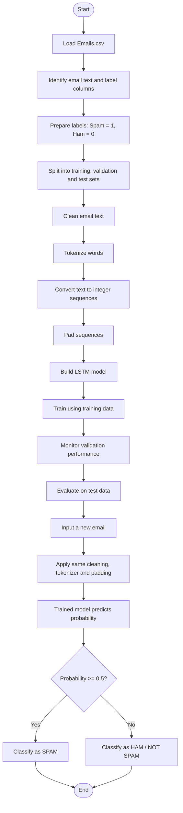
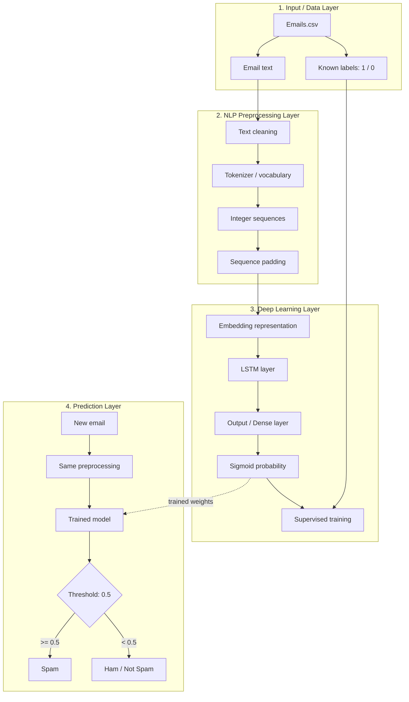

# Spam Email Detection Using TensorFlow, NLP and LSTM

A deep-learning project that classifies email messages as **Spam** or **Ham (Not Spam)** using Natural Language Processing (NLP) and an LSTM neural network built with TensorFlow/Keras.

> **Dataset note:** The project uses a labelled `Emails.csv` dataset. The labels are supplied with the dataset; the model learns from these examples. In the data used for this project, `1` represents Spam and `0` represents Ham. Confirm the actual column names in your CSV before configuring the script.

---

## Table of Contents

- [Project Overview](#project-overview)
- [Objectives](#objectives)
- [Technology Stack](#technology-stack)
- [Dataset](#dataset)
- [Project Workflow](#project-workflow)
- [Workflow Flowchart](#workflow-flowchart)
- [System Architecture](#system-architecture)
- [How the LSTM Model Works](#how-the-lstm-model-works)
- [Prediction Logic](#prediction-logic)
- [Installation](#installation)
- [Running the Project](#running-the-project)
- [Evaluation](#evaluation)
- [Project Structure](#project-structure)
- [Limitations and Future Improvements](#limitations-and-future-improvements)

---

## Project Overview

Spam emails can contain unwanted advertisements, misleading offers, phishing attempts, or other unsolicited content. This project uses a supervised learning approach to distinguish spam emails from legitimate emails.

The program reads labelled email data, prepares the text for machine learning, trains an LSTM model, and uses the trained model to predict the class of an unseen email.

**Output classes:**

| Label | Meaning |
|---:|---|
| `1` | Spam |
| `0` | Ham (Not Spam) |

## Objectives

- Load and prepare a labelled email dataset.
- Convert raw email text into numerical sequences using NLP preprocessing.
- Train an LSTM model to learn patterns in email messages.
- Predict whether a new email is Spam or Ham.
- Evaluate the trained model using test data.

## Technology Stack

| Technology / Library | Purpose |
|---|---|
| Python | Main programming language |
| Pandas | Loading and handling the CSV dataset |
| NumPy | Numerical operations |
| TensorFlow / Keras | Building and training the deep-learning model |
| NLP text-processing utilities | Preparing email text |
| Tokenizer and sequence padding | Converting text into fixed-length numerical input |
| Scikit-learn | Dataset splitting and/or evaluation utilities, where used in the script |

The exact libraries used depend on the imports in the project script.

## Dataset

The project uses **`Emails.csv`**, which contains email message text and a corresponding class label.

Example of the logical dataset format:

| Email message | Label |
|---|---:|
| Congratulations! You have won a prize. | 1 |
| Please find the meeting notes attached. | 0 |

The labels are already present in the dataset. They are the target values used during supervised training; the LSTM does not create the original labels.

The script searches for likely text and label column names. Make sure the CSV headers match one of the names supported by the code, or update the column-selection logic.

## Project Workflow

1. **Load dataset** — Read `Emails.csv` into a Pandas DataFrame.
2. **Identify text and labels** — Select the email-content column and the target-label column.
3. **Prepare labels** — Map the dataset's classes to numeric values (`1` for Spam and `0` for Ham).
4. **Split the data** — Divide the labelled examples into training, validation, and testing sets.
5. **Clean email text** — Apply the text-cleaning steps implemented in the script.
6. **Tokenize text** — Build a vocabulary and convert words into integer sequences.
7. **Pad sequences** — Make sequences a consistent length so they can be supplied to the model in batches.
8. **Build and train LSTM** — Train the neural network using the training sequences and their known labels; use validation data to monitor training.
9. **Evaluate model** — Test the trained model on held-out test data.
10. **Predict new emails** — Convert a new email using the same tokenizer and padding configuration, then obtain a prediction from the model.
11. **Classify output** — Apply the configured probability threshold (described below) to display Spam or Ham.

## Workflow Flowchart



## System Architecture

The system can be understood as four connected layers:

1. **Data layer:** provides email text and its known labels.
2. **Preprocessing layer:** cleans and converts text into padded numerical sequences.
3. **Model layer:** the LSTM network learns from the prepared training examples.
4. **Prediction layer:** receives a new email and returns a Spam/Ham classification.

### High-level architecture diagram



**Architecture clarification:** The diagram illustrates a common text-classification LSTM pipeline and the workflow described for this project. The `Embedding → LSTM → Dense/Sigmoid` sequence is a conceptual representation; verify the actual model definition in your Python script before treating those as the exact implemented layers. The same applies to the 0.5 threshold: it matches the prediction rule described for this project.

## How the LSTM Model Works

**LSTM** stands for **Long Short-Term Memory**. It is a type of recurrent neural network (RNN) designed to process sequential data.

In this project:

- The tokenizer converts words into integer IDs.
- The embedding representation (if present in the model) maps token IDs to dense vectors.
- The LSTM processes the sequence and learns useful contextual patterns.
- The output layer produces a value that can be interpreted as a spam probability when configured with a sigmoid activation.

For example, an email containing phrases such as "claim your prize" or "limited time offer" may contain patterns the model learned to associate with spam. The model learns these patterns from labelled examples; it does not rely on a manually written list of spam words.

## Prediction Logic

The model returns a probability between `0` and `1`. The project uses a threshold of `0.5` in its described prediction logic:

```python
prediction = model.predict(email_padded)

if prediction[0][0] >= 0.5:
    print("SPAM")
else:
    print("HAM (NOT SPAM)")
```

The probability is a model score, not a guarantee. The threshold can be tuned using validation data depending on the relative cost of false positives and false negatives.

## Installation

### 1. Clone the repository

```bash
git clone <your-repository-url>
cd <your-project-folder>
```

### 2. Create and activate a virtual environment (recommended)

```bash
python -m venv venv
```

On Windows:

```bash
venv\Scripts\activate
```

On Linux / macOS:

```bash
source venv/bin/activate
```

### 3. Install dependencies

Install the libraries imported by your project script. A typical starting point is:

```bash
pip install pandas numpy scikit-learn tensorflow
```

If your code imports additional packages, install those as well.

### 4. Add the dataset

Place `Emails.csv` in the location expected by the Python script. If the script uses a relative path, running it from the project directory is usually simplest.

## Running the Project

Run the Python file that contains your project code:

```bash
python <your-script-name>.py
```

Replace `<your-script-name>.py` with the actual filename. Ensure the dataset path and CSV column names are correct before running.

## Evaluation

Evaluate the model on the held-out test set rather than only the data used for training. Useful classification metrics include:

- **Accuracy:** overall proportion of correct predictions.
- **Precision:** among emails predicted as spam, how many are actually spam?
- **Recall:** among all actual spam emails, how many did the model detect?
- **F1-score:** harmonic mean of precision and recall.
- **Confusion matrix:** counts of correct and incorrect predictions for each class.

Do not add performance figures to the README unless they have been measured by running the project and evaluating the test set.

## Project Structure

A suggested repository layout is:

```text
spam-email-detection/
│
├── Emails.csv                 # Labelled email dataset
├── <your-script-name>.py      # Main Python project script
├── README.md                  # Project documentation
└── requirements.txt           # Python dependencies (optional)
```

Adjust the filenames to match the files in your actual repository.

## Limitations and Future Improvements

- Model quality depends on the size, quality, and balance of the labelled dataset.
- New spam techniques may differ from patterns present in the training data.
- Incorrect or inconsistent dataset labels can affect model performance.
- A 0.5 decision threshold may not be optimal for every use case.
- The model should be tested on fresh, unseen emails before practical deployment.

Possible future improvements:

- Add a simple web interface for entering email text.
- Tune the tokenizer vocabulary size, sequence length, and model hyperparameters.
- Compare LSTM with traditional ML models and other neural architectures.
- Tune the classification threshold using validation results.
- Save and load the trained model and tokenizer for reuse.
- Add monitoring and periodic retraining with newly labelled examples.

---

## Author

[Mayank Raj](https://github.com/PoisonMunna) 
